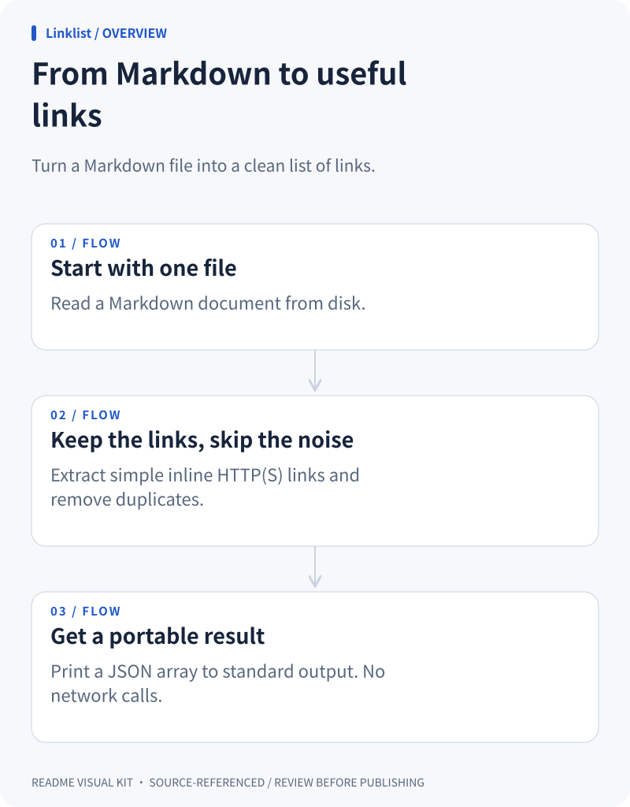

# README Visual Kit

**A README people can understand before they install.**

Turn source-referenced project notes into three matching diagrams: **how it works, how it fits together, and how to start**. Local SVG renderer + a portable agent skill. No API key. No runtime dependencies.

[中文说明](README.zh-CN.md) · [Live demo](https://tianfuzhibuyuci.github.io/readme-visual-kit/) · [Manifest reference](references/manifest.md)


<details>
<summary>See a complete generated SVG / 查看完整生成图</summary>



</details>

> Status: v0.1.0 — a working local MVP, not a hosted service. The examples below are small fixtures created for this repository, not external users or endorsements.

## Try it in 30 seconds

Download or clone this repository, open a terminal in its folder, and use **Node.js 22+**:

```sh
node scripts/cli.mjs render examples/cli/visuals.json --root examples/cli --out demo
```

Open `demo/index.html` in your browser. No `npm install`, account, token or build step. If `demo` already exists, choose another output name; the tool will not overwrite it.

**Prefer browsing first?** [Try the live gallery](https://tianfuzhibuyuci.github.io/readme-visual-kit/) to explore all three included examples, in both themes. You can also open `docs/gallery/index.html` locally; the renderer and generated previews work offline.

## What you get

| File | Purpose |
|---|---|
| `overview.light.svg` + `.dark.svg` | Input → transformation → result |
| `architecture.light.svg` + `.dark.svg` | A simplified directed component diagram |
| `quickstart.light.svg` + `.dark.svg` | The shortest path to a first result |
| `visuals.json` | Editable diagram source |
| `README-snippet.md` | Copyable theme-aware `<picture>` embeds |
| `index.html` | Offline preview, tabs, theme switch, downloads and copy button |
| `evidence.json` | Source file/line references and copied excerpts |

On small screens the preview scrolls diagrams horizontally rather than shrinking the text to illegibility. The SVGs themselves scale to fit README containers; use shorter labels for narrow embeds.

## Not another “AI draws everything” app

- **Three useful diagrams, not a blank canvas.** A focused README workflow.
- **Source references, not invented features.** Every node links to a real file and line range. The checker does **not** verify the meaning of claims or edges.
- **Light and dark together.** Deterministic SVG output with no external font or asset requests.
- **Your agent, your model.** The skill helps an existing agent prepare the JSON. The CLI does not read an arbitrary repository and magically infer architecture, and it never calls a model API. Existing model usage may still cost money.
- **Editable and portable.** JSON, SVG and HTML remain yours. No service to keep alive.

## Use it on your project

1. Ask your coding agent to follow `SKILL.md` in this repository, or prepare JSON yourself using [the format](references/manifest.md).
2. Point it at the README and relevant source files. Keep every diagram to 2–6 nodes and verify source references.
3. Run validation and render. Below, `.` is your current project and `visuals.json` is your prepared manifest; replace the script path with the renderer's actual location:

   ```sh
   node /path/to/readme-visual-kit/scripts/cli.mjs check visuals.json --root .
   node /path/to/readme-visual-kit/scripts/cli.mjs render visuals.json --root . --out readme-visuals
   ```

4. Review the preview, particularly architecture arrows and quickstart commands. Open `README-snippet.md`, adjust image paths to `./readme-visuals/`, then copy into your README.
5. **Check privacy before committing:** source excerpts are included in the preview and evidence report. You may publish only the six SVGs if you do not want to share excerpts.

Suggested agent prompt:

> Follow the SKILL.md in readme-visual-kit. Use only this repository's README and relevant source files to make overview, architecture and quickstart diagrams. Show uncertainty explicitly, validate evidence, and render into a new readme-visuals folder. Do not run project commands or publish anything.

The root folder is a self-contained skill: keep `SKILL.md`, `scripts/`, `references/` and the example it references together. An agent can read it directly; optional installation/discovery depends on your client. No global configuration is changed by this project.

## Three runnable fixtures

| Example | Type | What it demonstrates |
|---|---|---|
| [Linklist](examples/cli/) | Node CLI | Markdown → deduplicated links → JSON |
| [Pocket Notes](examples/web/) | Browser app, Chinese | Input → save → local browser storage |
| [Text Utils](examples/library/) | Python library | Tiny functions, imports and dependency relationships |

The gallery contains pre-rendered outputs for each. Fixture limitations are documented in their own READMEs.

## Development

```sh
npm test
```

Uses Node's built-in test runner; no third-party runtime or test packages. The CI definition exercises Node 22 and 24 on Windows and Ubuntu. Browser QA performed for this release is recorded in [docs/QA.md](docs/QA.md); a workflow file is not a claim of a successful remote CI run.

## Limits & safety

- This is a **presentation aid**, not a full architecture analyzer. Architecture supports up to six nodes and a DAG; simplify cycles and dense relationships.
- Validation checks schema, safe local paths and line bounds, not semantic truth. Source references can become stale.
- Commands are rendered as text, never executed. The CLI makes no network requests.
- Existing output directories are refused. A disk failure during writing can leave a partial new directory; choose a new directory after addressing the failure.
- Fonts use the viewer's local system fonts. CJK is supported by wrapping, but font availability varies. Review long labels, complex scripts and emoji visually.
- SVG edits do not round-trip into JSON. This is not a drag-and-drop editor.

## Contribute

A useful contribution starts with a failing test, a small fix and a before/after image when layout changes. Real examples with permission to share are welcome. Please remove secrets from evidence excerpts before attaching them to issues.

If this saves you time explaining a project, a Star helps others discover it. No star gates, paid stars or fake adoption numbers.

MIT licensed. See [LICENSE](LICENSE).
