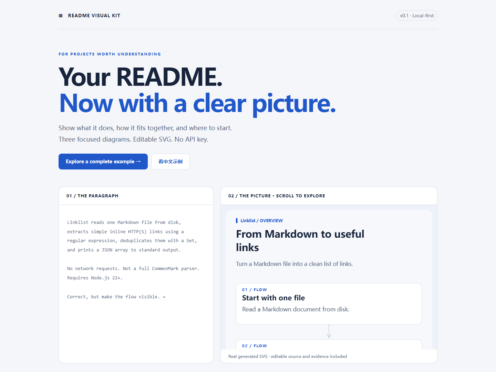
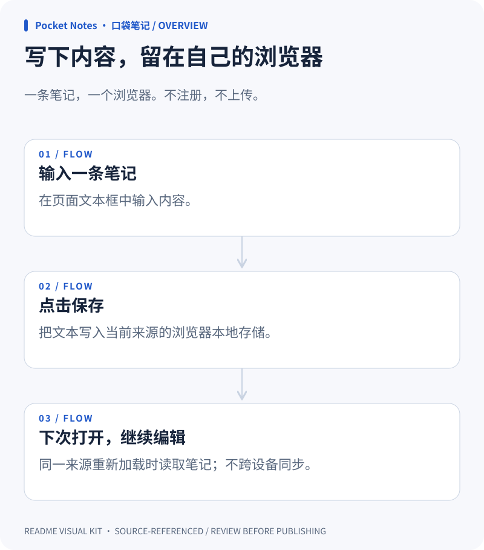

# README Visual Kit

**让别人不用安装，就先看懂你的项目。**

把带源码依据的项目说明，变成三张统一风格的图：**功能流程、简化架构、快速上手**。本地 SVG 渲染器 + 可携带的 Agent Skill，无需 API Key、无第三方运行依赖。

[English](README.md) · [本地示例画廊](docs/gallery/index.html) · [输入格式](references/manifest.md)



<details>
<summary>See a complete generated SVG / 查看完整生成图</summary>



</details>

> v0.1.0 是可运行的本地 MVP，不是在线 AI 服务。三个示例都是为本项目编写的演示程序，不代表第三方用户或真实商业采用。

## 30 秒试用

下载或克隆本仓库，进入目录，准备 **Node.js 22+**：

```sh
node scripts/cli.mjs render examples/cli/visuals.json --root examples/cli --out demo
```

然后双击 `demo/index.html`。不需要 `npm install`、登录或密钥。若 `demo` 已存在，请换一个输出目录名；工具不会覆盖旧目录。

也可以先双击 `docs/gallery/index.html` 查看三个完整示例。GitHub 的文件页面不会直接运行这些 HTML；下载后打开，或将 `/docs` 配置为 GitHub Pages 发布目录。

## 产出什么

- **功能流程图**：输入 → 处理 → 输出。
- **简化架构图**：关键组件及有向关系，不画不存在的数据库和服务。
- **快速上手图**：从准备环境到第一次跑通。
- 每张都有明暗两版 SVG，共六张；另含可编辑 JSON、README 嵌入片段、离线预览、来源报告。
- 预览支持切换图表/主题、下载和复制片段。手机端保持可读字号，横向滑动看图。

## 和“AI 随便画张图”有什么不同

**范围小、依据明确、可以修改。** 每个节点必须引用项目内真实文件和行号。渲染器检查文件和行范围是否存在，但**不证明描述或连线在语义上正确**；仍需要人或 Agent 审查。

它不提供托管模型，不自动扫描整个仓库推断架构。你现有的 Agent 整理 JSON，本地脚本负责校验与绘图；使用已有模型仍可能产生模型费用。

## 给自己的项目生成

1. 让编码助手阅读本仓库根目录 `SKILL.md`，再读取目标项目 README 和相关源码；也可按照 [输入格式](references/manifest.md) 自己写 JSON。
2. 用 2–6 个节点讲清每张图，不确定的内容写 `uncertainty`，不要编造。
3. 在目标项目目录里运行（脚本路径替换为你本机的实际路径）：

   ```sh
   node /path/to/readme-visual-kit/scripts/cli.mjs check visuals.json --root .
   node /path/to/readme-visual-kit/scripts/cli.mjs render visuals.json --root . --out readme-visuals
   ```

4. 打开生成的 `index.html`，检查三张图、两套主题、架构箭头和命令。
5. 复制 `README-snippet.md` 时，把图片路径前缀改为 `./readme-visuals/`。

可直接给 Agent 的提示：

> 按照 readme-visual-kit 中的 SKILL.md，为当前项目生成三张 README 图。仅依据 README 和相关源码，每个节点引用文件行号，不确定项明确标注。先校验，再输出到新的 readme-visuals 目录。不要执行项目命令，也不要发布到 GitHub。

本仓库根目录就是一个完整 Skill。整体保留 `SKILL.md`、`scripts/`、`references/` 和引用到的示例，交给支持读取 Skill 的客户端；不同客户端的安装目录和自动发现方式各异。本工具不会修改你的全局配置。

## 发布前必须注意

`evidence.json` 和预览 HTML 包含引用的**源码片段**，可能含私有信息。发布前逐项审查；如果只想公开图，只上传六张 SVG 即可。不要把密钥写进输入 JSON。

来源校验不是事实认证，也不会固定到 Git 提交；源码变化后应重新检查。输出目录必须不存在且其父目录已存在。磁盘错误可能留下部分新文件，处理原因后换一个新目录再生成。

## 验收与限制

- 三类可运行自建示例：Node CLI、中文浏览器应用、Python 工具库。
- `npm test` 运行内置测试，无需安装依赖；测试覆盖校验、转义、路径安全、可编辑源保留和 CLI。
- 本次视觉检查见 [QA 记录](docs/QA.md)。CI 配置存在不代表已经在 GitHub 上跑过。
- 架构只支持最多六节点的有向无环图；循环需先抽象，复杂图应换更专业的工具。
- 手机预览可横向滑动；README 内 SVG 会按容器缩放，应尽量使用短标签。
- 字体来自本机，中文会换行，但复杂文字和 emoji 仍需人工检查。
- 不是拖拽画布，不提供 SVG 修改反向同步 JSON。

欢迎提供可公开的真实项目示例、Bug 或带测试的改进。如果它帮你省下解释项目的时间，欢迎点一个 Star。不会要求先 Star 才能使用，也不承诺获得特定 Star 数。

MIT 开源许可，见 [LICENSE](LICENSE)。
