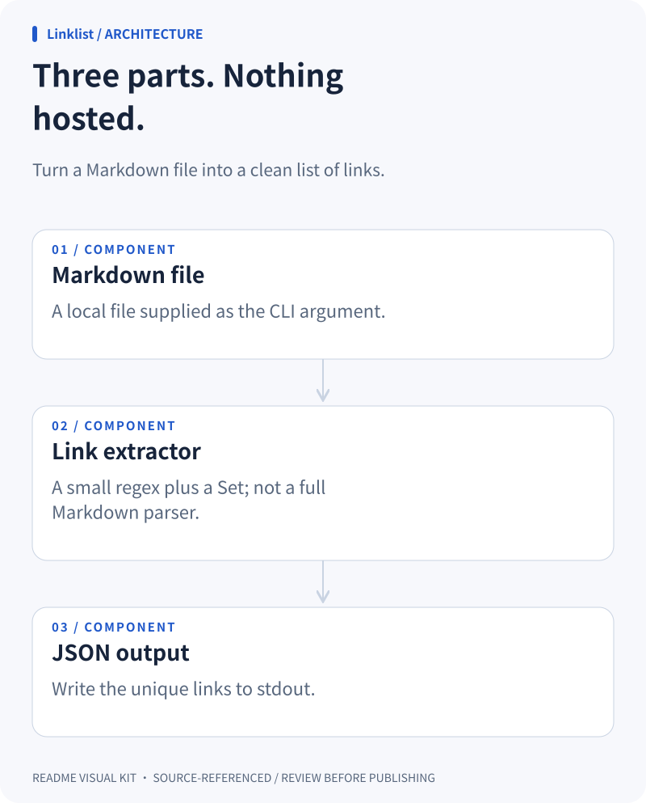
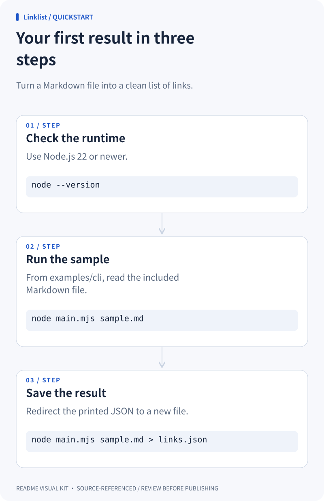

### From Markdown to useful links

<picture>
  <source media="(prefers-color-scheme: dark)" srcset="./overview.dark.svg">
  
</picture>

### Three parts. Nothing hosted.

<picture>
  <source media="(prefers-color-scheme: dark)" srcset="./architecture.dark.svg">
  
</picture>

### Your first result in three steps

<picture>
  <source media="(prefers-color-scheme: dark)" srcset="./quickstart.dark.svg">
  
</picture>
