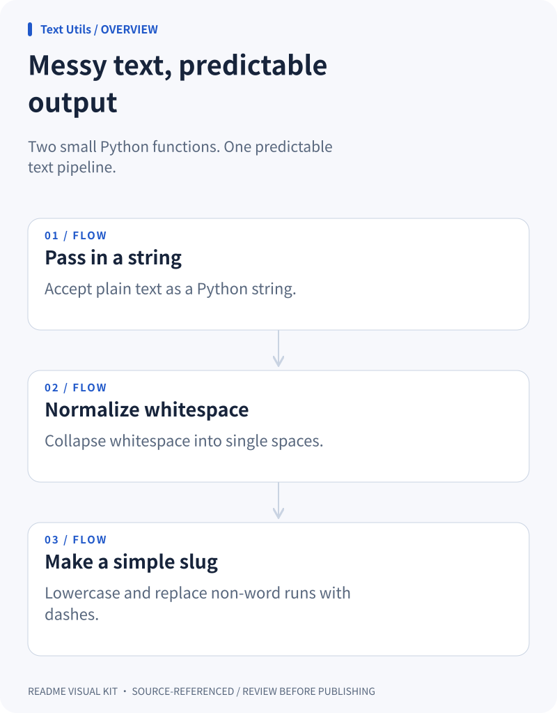

### Messy text, predictable output

<picture>
  <source media="(prefers-color-scheme: dark)" srcset="./overview.dark.svg">
  
</picture>

### Standard library, small surface

<picture>
  <source media="(prefers-color-scheme: dark)" srcset="./architecture.dark.svg">
  
</picture>

### Try both helpers, then import

<picture>
  <source media="(prefers-color-scheme: dark)" srcset="./quickstart.dark.svg">
  
</picture>
