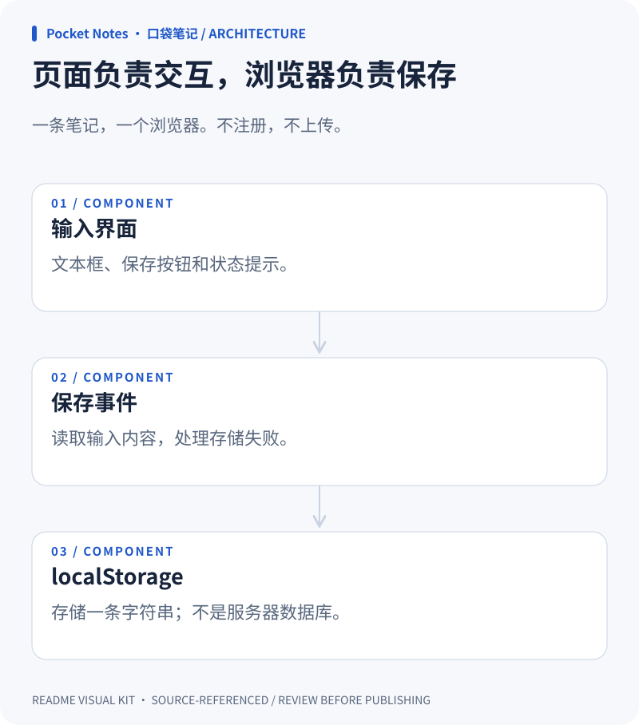
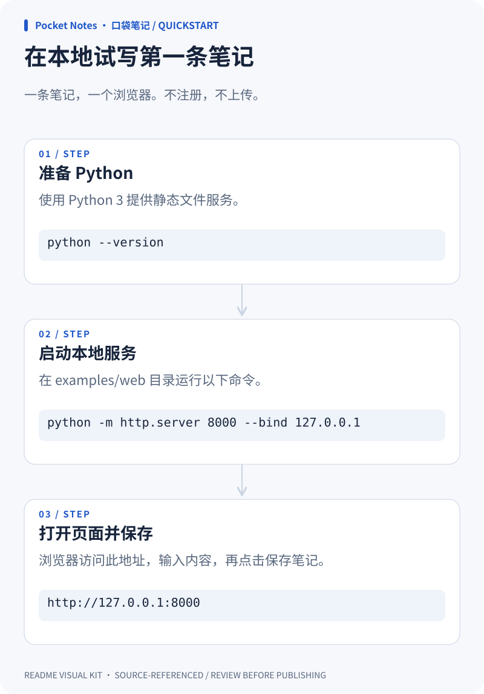

### 写下内容，留在自己的浏览器

<picture>
  <source media="(prefers-color-scheme: dark)" srcset="./overview.dark.svg">
  
</picture>

### 页面负责交互，浏览器负责保存

<picture>
  <source media="(prefers-color-scheme: dark)" srcset="./architecture.dark.svg">
  
</picture>

### 在本地试写第一条笔记

<picture>
  <source media="(prefers-color-scheme: dark)" srcset="./quickstart.dark.svg">
  
</picture>
